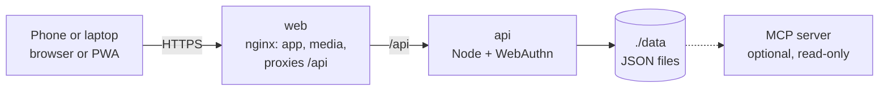

<div align="center">

# GymBro

**Your friendly, self-hosted gym buddy.** · **เพื่อนซี้สายฟิต ที่คุณเป็นเจ้าของเอง**

Plan your week, run guided workouts, log every set and your body weight,<br>
on your phone, synced across your devices, behind your own passkey login.

[Self-hosting guide](docs/SELF_HOSTING.md) ·
[Phone app](docs/MOBILE.md) ·
[FAQ](docs/FAQ.md) ·
[Changelog](CHANGELOG.md)

</div>

## Why GymBro

Most workout apps keep your data on their servers, push you towards a subscription, or vanish
when the company does. GymBro runs on your own box and keeps your data in a folder you control.
It still behaves like a modern app: installable on the home screen, passkey sign-in, works
offline, syncs between your phone and your laptop.

No account on someone else's server, no subscription, no ads, no telemetry, and no AI calling
home. One `docker compose up` and it's running.

GymBro is a fork of [openGym](https://github.com/DuarteSantos8/openGym) by Duarte Santos. It keeps
the training engine and adds a warmer, friendlier look. It's built for Thai lifters too, with a
complete Thai interface and Thai exercise names. The optional AI coach is gone.

## Features

**Planning**

- A routine per weekday over a library of **over 5,600 exercises** with animated demos,
  searchable and browsable by muscle on a body map. Filter by the equipment you own.
- Starter plans (Push/Pull/Legs, Upper/Lower, Full Body, 5×5) that load as ordinary, editable
  routines.
- Or skip the weekdays: a **rotation** (A, B, C, A, ...) where the next session is simply the
  next one you haven't done.
- Supersets, warm-up sets, drop sets and rest-pause, timed exercises, cardio by time and speed,
  rest time per exercise, planned deloads.
- Your own exercises, with your own photo, GIF or short video.

**Training**

- Guided sessions: today's workout starts itself, weights are pre-filled from last time, a rest
  timer runs between sets, PRs are detected as you go.
- Optional effort column as RIR or RPE, plate math for every bar, per-side reps, and a screen
  that stays awake while you train.

**Progress**

- Progression rules per routine or per exercise: linear, Greyskull LP, double and triple
  progression, or adding time. Each target explains why it is that number.
- Estimated 1RM curves, Structural Balance ratios, a year-long activity heatmap, and a muscle map
  of volume, recovery and what has gone untrained.
- Body-weight chart against a goal line, and progress photos with a before/after slider.

**Accounts and data**

- Passkeys (Face ID, Touch ID, fingerprint) with data synced across devices. Two devices editing
  at once merge field by field instead of overwriting each other.
- Import from FitNotes, Strong, Hevy and Apple Health. Export everything as one JSON file.
- Optional admin dashboard with invite-only signup and an activity log.
- 19 languages, **Thai (ภาษาไทย) included**, plus right-to-left Arabic.

## ภาษาไทย

GymBro แปลเป็นภาษาไทยครบทุกหน้าจอ รวมถึงชื่อท่าออกกำลังกายและคำแนะนำ เลือกได้ที่
**ตั้งค่า → หน่วยและภาษา** หรือตั้งให้เป็นภาษาเริ่มต้นของเซิร์ฟเวอร์ด้วย `DEFAULT_LANG=th` ในไฟล์ `.env`

## Quick start

You need [Docker](https://docs.docker.com/get-docker/) with Compose.

```bash
git clone https://github.com/YOUR-GITHUB-USER/gymbro
cd gymbro
cp .env.example .env
docker compose up -d --build
```

Open <http://localhost:8080>, tap **Create profile**, and you're in. For Thai as the default
language on your instance, add `DEFAULT_LANG=th` to `.env`.

To reach it from your phone with passkeys you need HTTPS on a domain; that's a two-line change in
`.env`. The [self-hosting guide](docs/SELF_HOSTING.md) walks through Cloudflare Tunnel, Caddy,
Traefik and nginx, and there are separate guides for [HTTPS on a LAN](docs/SELF_HOSTING_HTTPS.md)
and [Kubernetes](docs/SELF_HOSTING_KUBERNETES.md).

<details>
<summary><b>Configuration reference</b> (all through <code>.env</code>)</summary>

| Variable | What it does | Default |
|---|---|---|
| `RP_ID` | Hostname passkeys are bound to | `localhost` |
| `ORIGIN` | Full URL the app is served from | `http://localhost:8080` |
| `WEB_PORT` | Host port for the web UI | `8080` |
| `NGINX_PORT` | Port the web container listens on inside the container | `80` |
| `BACKEND` | Name of the API service that `/api` is proxied to | `api` |
| `PORT` | Port the API listens on; the web container proxies to the same value | `3000` |
| `RP_NAME` | Name shown in the passkey prompt | `GymBro` |
| `DEFAULT_LANG` | Language for the sign-in screen and new profiles, e.g. `th` | *(browser's)* |
| `SESSION_DAYS` | How long a sign-in lasts, in days | `90` |
| `ADMIN_UIDS` | User ids that get the admin dashboard, comma-separated | *(none)* |
| `FIRST_USER_ADMIN` | `1`: the first profile created on an empty instance becomes its admin | *(off)* |
| `INVITE_ONLY` | Require an invite code to create a profile | *(off)* |
| `ALLOW_GUEST` | Offer "Continue without account"; `0` requires a profile | *(on)* |
| `PASSWORD_LOGIN` | Offer name-and-password sign-in next to passkeys | *(off)* |
| `TRUST_PROXY` | Let the sign-in throttle read the client address from proxy headers | `1` in `docker-compose.yml` |
| `AUDIT_LOG` | Record sign-ins and admin actions; `0` records nothing | *(on)* |
| `AUDIT_MAX` | Events kept in the activity log; `0` for no limit | `5000` |
| `AUDIT_DAYS` | Days kept in the activity log; `0` keeps until `AUDIT_MAX` | `90` |
| `AUDIT_IP` | Record the caller's address: `off`, `net` (network only) or `full` | `off` |
| `ALLOWED_PRIVATE_IPS` | Private addresses push endpoints may resolve to: comma-separated IPs, `a-b` ranges or CIDR blocks | *(none)* |
| `VAPID_SUBJECT` | Contact URL sent with push notifications | your `ORIGIN` |

Push-notification keys are generated on first run into `./data/vapid.json`. `DATA_DIR` is pinned to
`/data` inside the container and mapped to `./data` on the host; change the volume, not the
variable. The [self-hosting guide](docs/SELF_HOSTING.md) covers every option in detail.

</details>

## Phone app

The same codebase builds a standalone app with Capacitor: no account, no server, everything stays
on the phone, with native reminders and a rest countdown in the notification shade. Signed APKs go
on the [releases page](https://github.com/YOUR-GITHUB-USER/gymbro/releases); on iPhone, self-host
and add the PWA to your home screen from Safari. Details: [docs/MOBILE.md](docs/MOBILE.md).

## How it works



- **`frontend/`** is React 19 and Vite (React Router, Zustand), built to static files inside Docker.
- **`api/`** is plain `node:http` with two dependencies: `@simplewebauthn/server` for passkeys and
  `web-push` for notifications. Everything is stored as JSON under `./data`.
- **`web/`** builds the frontend and serves it with nginx, proxying `/api` so the whole app sits on
  one origin, which passkeys require.

The training logic (progression rules, 1RM, how a logged session is read back) lives in pure
functions under `frontend/src/lib/` with tests beside them. The HTTP API is documented in
[`api/openapi.yaml`](api/openapi.yaml).

### Your data

Everything lives in `./data` on your host: `db.json` (profiles and public passkey data),
`state-<user>.json` (each user's plan, workouts, body weight and settings), `audit.log`, `secret`
(the session-cookie signing key) and `uploads/`. Back up `./data` and you've backed up everything.

## Documentation

| I want to | Read |
|---|---|
| Get a quick answer | [FAQ](docs/FAQ.md) |
| Set up my own instance | [Self-hosting](docs/SELF_HOSTING.md) |
| Use the Android or iPhone app | [Phone app](docs/MOBILE.md) |
| Bring my history from another app | [Importing data](docs/DATA_IMPORTS.md) |
| Contribute code | [Contributing](CONTRIBUTING.md) |
| Report a security problem | [Security](SECURITY.md) |

## How GymBro is built

GymBro, like openGym before it, is developed with [Claude Code](https://claude.com/claude-code).
A person decides what goes in and ships it; the training logic is covered by unit tests, and pull
requests run the frontend, API and MCP suites in CI. The app itself calls no AI service.

## License

**GymBro's code** is licensed under the [GNU AGPL v3.0](LICENSE), as openGym's is. You can
self-host, use, modify and share it; if you run a modified version as a network service, you have
to offer that version's source under the same license. Original work © 2026 Duarte Santos.

> [!IMPORTANT]
> **The exercise media is not covered by that license.** The stills and animations are
> © Aliaksandr Makatserchyk, [Gym visual](https://gymvisual.com/), licensed for use in openGym
> only. A non-commercial fork may keep them unmodified, at 180 px, together with the notice;
> anything else, including any commercial use of GymBro, needs your own licence from
> gymvisual.com. See [NOTICE.md](NOTICE.md).

Full third-party notices, including the body-diagram geometry and the exercise text, are in
[NOTICE.md](NOTICE.md).
